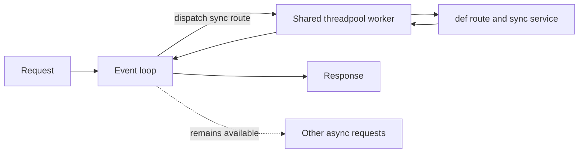
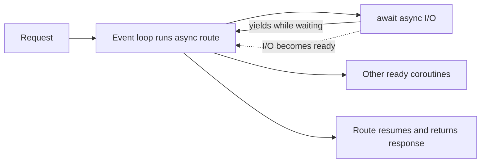
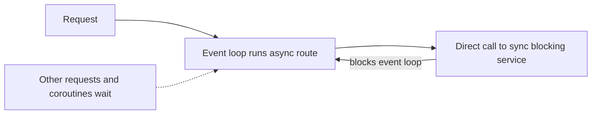

# Async I/O

## Synchronous and asynchronous calls

- A **synchronous call** makes its caller wait until the call finishes.
- An **asynchronous call** lets the caller make progress on other work while an
  operation is waiting, then use its result when it is ready. The language and
  runtime determine how that work is scheduled.
- Async does not inherently mean “run on another thread” or “run in parallel.”
  It is especially useful for overlapping I/O waits; CPU-heavy work needs a
  separate way to use multiple cores.

## How Python async works in FastAPI

Python's `async` and `await` keywords let a function pause while it waits for
an asynchronous operation. The standard-library `asyncio` provides tools such
as an event loop to schedule these coroutines. When Uvicorn runs FastAPI, the
application handles routes in two ways:

- An `async def` route runs as a coroutine on the event loop. When it awaits
  async I/O, it pauses so the loop can run another ready coroutine. It does
  not start a new thread for the route.
- A normal `def` route runs on a worker thread from FastAPI's shared
  threadpool. If it blocks while waiting, that thread stays occupied until the
  wait ends, though it usually uses little CPU.

A paused coroutine still uses memory, but does not need its own thread. This
can make async I/O efficient when many requests are waiting at once.

**This does not mean every I/O route should be async.** Choose async when the
libraries provide awaitable operations and overlapping waits is useful; a
normal `def` route remains appropriate for synchronous libraries. Async helps
manage waiting work, but by itself does not parallelize CPU-heavy work across
cores within one worker. CPU-heavy code can block that worker's event loop and
delay its other requests; use multiple worker processes or a process pool when
CPU parallelism is needed.

## Choose synchronous or asynchronous route functions

Choose the route style by checking what the route and its dependencies do. In
particular, find out whether the database driver, HTTP client, and other
libraries provide synchronous calls or awaitable asynchronous calls. A route's
`async` keyword does not change how those libraries behave.

- Use `async def` when the route awaits async-compatible I/O. While it waits at
  `await`, the event loop can run other ready coroutines. Async can improve
  concurrency for I/O waits, but it does not increase the capacity of the
  database or other services the application depends on.
- Use a normal `def` route when it calls synchronous or blocking libraries.
  FastAPI runs the route in its shared threadpool, keeping that blocking work
  off the event-loop thread.
- For CPU-heavy processing, neither `async def` nor adding threads automatically
  makes the work faster. Consider a process pool or background-worker system;
  parallel processing is bounded by available CPU cores.

Do not call blocking synchronous code directly from an `async def` route. That
call runs on the event-loop thread; FastAPI does not automatically move it to
the threadpool, so it can block progress for other coroutines.

For example, this synchronous call blocks the event loop when called directly
from an `async def` route:

```python
async def route():
    result = service.load_data()  # synchronous call; no implicit threadpool
    return result
```

When a service uses an async HTTP client such as `httpx.AsyncClient`, its
request is awaitable and the route can await the service:

```python
import httpx

class AsyncService:
    def __init__(self, client: httpx.AsyncClient) -> None:
        self._client = client

    async def load_data(self) -> dict:
        response = await self._client.get("https://httpbin.org/json")
        response.raise_for_status()
        return response.json()

async def route(service: AsyncService) -> dict:
    return await service.load_data()
```

`load_data()` is asynchronous because it awaits the HTTP request. While the
response is in transit, this coroutine pauses and the event loop can run other
ready coroutines. Adding `await` does not make a synchronous operation
non-blocking.

If the needed library is synchronous, keep the route synchronous or deliberately
offload the blocking operation to a worker thread. **Choose async because the
I/O and libraries support it, not just because the framework offers it.** Align
the route, service, and I/O libraries.

## Limit concurrent work for each execution model

- Synchronous FastAPI route handlers and dependencies use a shared threadpool.
  This project configures its capacity with `SYNC_THREADPOOL_SIZE`, which
  defaults to 40 workers. When all workers are busy, additional synchronous
  work waits for a worker.
- Awaitable async I/O does not use that synchronous threadpool. If a particular
  downstream service or operation has limited capacity, an `asyncio.Semaphore`
  can limit how many coroutines use it at once. Other coroutines wait
  asynchronously for a semaphore slot, leaving the event loop available.

For example, this allows at most 10 concurrent calls to the protected async
operation:

```python
service_limit = asyncio.Semaphore(10)

async def call_service():
    async with service_limit:
        return await async_client.fetch()
```

Use a semaphore when it protects a specific constrained resource; it is not
necessary on every async route. A semaphore is local to its process, so each
server worker has its own limit.

## Three request execution scenarios

### Synchronous route with synchronous code

FastAPI dispatches synchronous route handlers and dependencies to its shared
threadpool. The event loop can continue processing other requests while a
worker runs.



### Async route awaiting async I/O

The route runs as a coroutine on the event loop. At an `await` for async I/O,
it yields so the loop can progress other ready coroutines.



### Async route calling synchronous blocking code

A direct call to a blocking synchronous service stays on the event-loop thread.
While it runs, the loop cannot progress other coroutines.



**Avoid this pattern.** Use an async-compatible operation, keep the route
synchronous, or deliberately offload the blocking work so it does not block the
event loop.

### Diagnose a blocking call

- Check whether other requests slow down or stall while one route is waiting
  or performing work.
- Trace the route through its service and other dependencies to find calls
  that block, such as synchronous HTTP/database clients or `time.sleep()`.
- Check the library documentation to see whether the call is synchronous or
  awaitable. An `async def` wrapper does not make a synchronous library call
  non-blocking.
- Reproduce the behavior with concurrent requests and use logs, tracing, or a
  profiler to confirm where time is spent.

## Project and Task CRUD and database connection limits

Project and Task CRUD currently uses a synchronous SQLAlchemy `Session` and
synchronous database operations:

```text
def router -> def service -> def repository -> Session -> PostgreSQL
```

- The normal `def` routes keep those blocking calls in FastAPI's threadpool.
- Changing only the route to `async def` would not make database calls
  awaitable; it would run the blocking calls on the event-loop thread.
- A fully async database path requires an async SQLAlchemy engine,
  `AsyncSession`, an asyncio-compatible PostgreSQL driver, and awaited calls
  through the repository, service, and route layers.
- The database connection pool limits how many operations can use a database
  connection at once, whether the application path is synchronous or async.
  Requests wait when no connection is available.
- Increasing the synchronous threadpool beyond the database pool does not
  increase concurrent database queries; it can only let more requests wait for
  a connection.

The k6 demo compares simulated waits, not concurrent database queries. Its
results do not show that async removes the database connection-pool limit or
makes the database execute queries faster.

## I/O-bound versus CPU-bound work

| Work type | Async helps? | Example |
|---|---|---|
| I/O-bound | Can improve concurrency when the library provides an awaitable operation. | Waiting for an external HTTP API. |
| CPU-bound | No. Async does not make calculations faster. | Large in-process image processing. |

Both the threadpool and the async event loop have roles in request processing,
but neither is usually the right place for substantial CPU-heavy work. A
threadpool is a pool of workers, and it is useful for isolating blocking
synchronous I/O: while one thread waits, another can run. CPU-heavy Python code
keeps a worker busy and generally does not gain parallel execution from more
threads because of the Global Interpreter Lock (GIL).

For CPU-heavy work, Python offers several options:

- Use `concurrent.futures.ProcessPoolExecutor` or `multiprocessing` to run work
  in separate processes. Processes can execute Python code in parallel across
  CPU cores.
- Send longer-running jobs to a background-worker system. Its worker processes
  can queue work and, when needed, run across multiple machines.
- Optimize or divide the computation, or use specialized native libraries
  where appropriate.

**CPU-heavy parallelism is bounded by the CPU cores available to the worker
processes.** Adding more processes than available cores does not add CPU
capacity; the processes compete for those cores. Keep worker counts aligned
with available cores and monitor the queue. If work arrives faster than the
available CPU resources can process it, optimize the workload or add CPU
capacity, possibly across more machines.

## Compare sync vs. async I/O

Module 09 compares two public routes that simulate waiting for a slow external dependency. The simulated wait is not useful application work; it stands in for time spent waiting for a remote HTTP API, file system, cloud service, or an async-compatible database driver.

| Route | Implementation | What the demo shows |
|---|---|---|
| `GET /async-demo/sync-wait?seconds=0.25` | A normal `def` route with `time.sleep()` | FastAPI places blocking synchronous work in its threadpool. |
| `GET /async-demo/async-wait?seconds=0.25` | An `async def` route with `await asyncio.sleep()` | The coroutine yields to the event loop while it waits. |

Both endpoints are public so the demonstration focuses on concurrency rather than authorization. They accept an optional `seconds` query parameter from `0` through `3`; valid requests return `200 OK`. The simulated `asyncio.sleep()` is a deterministic stand-in for waiting on an external service, file operation, or async-compatible database driver.

## Match the route style to its I/O

The demo contrasts a synchronous blocking wait with an awaitable wait:

```python
async def wait_asynchronously(seconds: float) -> WaitResponse:
    await asyncio.sleep(seconds)
```

At `await`, the coroutine pauses and the event loop can run other ready
coroutines. Async does not make the external operation itself faster; it lets
other requests make progress while this request waits.

The Module 09 routes are small, deterministic demonstrations:

- [`app/routers/async_demo.py`](../app/routers/async_demo.py) exposes public
  synchronous and asynchronous wait endpoints.
- [`app/services/async_demo.py`](../app/services/async_demo.py) uses
  `time.sleep()` and `asyncio.sleep()` as stand-ins for slow I/O.

Avoid blocking calls inside `async def`. A synchronous HTTP client,
synchronous database driver, or `time.sleep()` in an async route blocks the
event loop and prevents other async requests from progressing.

## k6 load script

[k6](https://grafana.com/docs/k6/latest/) is a command-line load-testing tool. Unlike pytest, it starts virtual users that make real HTTP requests to a running API and then summarizes timing, request-count, and check results.

The course script is [scripts/load/async-demo.js](../scripts/load/async-demo.js). Read its comments to see how the virtual-user scenario, command-line endpoint selection, HTTP request, and response check work together.

The k6 script starts 80 virtual users, each making one request. With the same simulated `0.25`-second (250 ms) wait, async requests can wait together. Synchronous requests use threadpool workers, so requests beyond the configured worker limit wait for an earlier group to finish.

| Scenario | Thread pool size | Total requests | Each request wait time | Expected request batches | Expected completion time |
|---|---:|---:|---:|---|---|
| Synchronous route | 40 threads (default) | 80 | 250 ms | 2 batches (40 concurrent requests each) | `2 × 250 ms = 500 ms` |
| Synchronous route | 10 threads | 80 | 250 ms | 8 batches (10 concurrent requests each) | `8 × 250 ms = 2,000 ms` |
| Asynchronous route | Not used | 80 | 250 ms | 1 batch (80 concurrent waits) | `1 × 250 ms = 250 ms` |
| Synchronous route | 80 threads | 80 | 250 ms | 1 batch (80 concurrent requests) | `1 × 250 ms = 250 ms` |

Each synchronous batch can run up to the thread-pool size of requests
concurrently; batches run one after another. The async route can have all 80
requests waiting concurrently while their coroutines yield at `await`.

The completion times are useful expectations for the total run and high-percentile request durations. Actual k6 measurements include local scheduling, startup, and network overhead, so they will be somewhat higher and can vary by machine.

This is a concurrency demonstration, not a production benchmark. The two endpoints use no database and no external network call, so the comparison isolates how the application waits.

## Run the demo

The application's synchronous threadpool defaults to 40 workers. The demo
configures `SYNC_THREADPOOL_SIZE` when starting the API so you can compare
different threadpool capacities.

### What you will compare

Each run sends 80 requests that each simulate a 250 ms wait:

1. A synchronous route with a 40-thread pool.
2. The same synchronous route with a 10-thread pool, which makes queued
   requests visible.
3. An asynchronous route while the pool remains at 10 threads. Its awaitable
   waits do not consume synchronous threadpool capacity.
4. The synchronous route with an 80-thread pool, enough threads for all 80
   simulated waits to run in one group.

### 1. Install k6

macOS with Homebrew:

```bash
brew install k6
```

Windows with Windows Package Manager (run in PowerShell or Windows Terminal):

```powershell
winget install k6 --source winget
```

See the [k6 Windows installation instructions](https://grafana.com/docs/k6/latest/set-up/install-k6/#windows)
for other Windows installation options.

For Linux, Docker, and other installation options, see the official
[Install k6](https://grafana.com/docs/k6/latest/set-up/install-k6/)
instructions.

### Run 1: synchronous route with a 40-thread pool

1. Start the API from the repository root in one terminal:

   macOS or Linux:

   ```bash
   SYNC_THREADPOOL_SIZE=40 uv run uvicorn app.main:app --reload
   ```

   Windows PowerShell:

   ```powershell
   $env:SYNC_THREADPOOL_SIZE = "40"; uv run uvicorn app.main:app --reload
   ```

2. In a second terminal at the repository root, execute the k6 script:

   macOS or Linux:

   ```bash
   ENDPOINT=sync-wait k6 run scripts/load/async-demo.js
   ```

   Windows PowerShell:

   ```powershell
   $env:ENDPOINT = "sync-wait"; k6 run scripts/load/async-demo.js
   ```

With 80 requests, this should require two batches of 40 blocking waits.

### Run 2: synchronous route with a smaller pool

1. Stop the API from Run 1 with `Ctrl+C`, then restart it from the repository
   root in one terminal with a 10-thread synchronous threadpool:

   macOS or Linux:

   ```bash
   SYNC_THREADPOOL_SIZE=10 uv run uvicorn app.main:app --reload
   ```

   Windows PowerShell:

   ```powershell
   $env:SYNC_THREADPOOL_SIZE = "10"; uv run uvicorn app.main:app --reload
   ```

2. In a second terminal at the repository root, execute the same synchronous
   k6 test again:

   macOS or Linux:

   ```bash
   ENDPOINT=sync-wait k6 run scripts/load/async-demo.js
   ```

   Windows PowerShell:

   ```powershell
   $env:ENDPOINT = "sync-wait"; k6 run scripts/load/async-demo.js
   ```

This time, the 80 requests should require eight batches of 10 blocking waits.

### Run 3: asynchronous route with the smaller pool

1. Keep the API running with the 10-thread pool from Run 2. Do not restart it.

2. In a second terminal at the repository root, execute the async k6 test:

   macOS or Linux:

   ```bash
   ENDPOINT=async-wait k6 run scripts/load/async-demo.js
   ```

   Windows PowerShell:

   ```powershell
   $env:ENDPOINT = "async-wait"; k6 run scripts/load/async-demo.js
   ```

The route's `await asyncio.sleep()` yields to the event loop, so its 80 waits
can overlap even though the synchronous threadpool remains limited to 10.

### Run 4: synchronous route with an 80-thread pool

1. Stop the API from Run 3 with `Ctrl+C`, then restart it from the repository
   root in one terminal with an 80-thread synchronous threadpool:

   macOS or Linux:

   ```bash
   SYNC_THREADPOOL_SIZE=80 uv run uvicorn app.main:app --reload
   ```

   Windows PowerShell:

   ```powershell
   $env:SYNC_THREADPOOL_SIZE = "80"; uv run uvicorn app.main:app --reload
   ```

2. In a second terminal at the repository root, execute the synchronous k6
   test:

   macOS or Linux:

   ```bash
   ENDPOINT=sync-wait k6 run scripts/load/async-demo.js
   ```

   Windows PowerShell:

   ```powershell
   $env:ENDPOINT = "sync-wait"; k6 run scripts/load/async-demo.js
   ```

With 80 threadpool workers, the 80 synchronous waits can run in one group. In
one run, the average request duration was 269.21 ms and p95 was 274.55 ms—close
to the asynchronous run. Timing varies by machine.

k6 reports request duration, percentile, request-count, and failure information at the end of each run. Do not compare a single laptop's numbers to a universal target; compare runs made on the same machine.

## k6 results

Record the `http_req_duration` values from each k6 summary in this comparison table. They represent individual client request durations.

| Scenario | Thread pool size | Each request wait time | Expected request batches | Expected completion time | Actual average request duration | Actual p95 request duration |
|---|---:|---:|---|---|---:|---:|
| Synchronous route | 40 threads (default) | 250 ms | 2 batches | `2 × 250 ms = 500 ms` | 530.35 ms | 533.16 ms |
| Synchronous route | 10 threads | 250 ms | 8 batches | `8 × 250 ms = 2,000 ms` | 2,060 ms | 2,060 ms |
| Asynchronous route | Not used | 250 ms | 1 batch (80 concurrent waits) | `1 × 250 ms = 250 ms` | 268.03 ms | 269.60 ms |
| Synchronous route | 80 threads | 250 ms | 1 batch (80 concurrent waits) | `1 × 250 ms = 250 ms` | 269.21 ms | 274.55 ms |

## Result analysis

All four runs completed 80 successful requests. The timing differences reflect how each route waits:

- With the default 40-thread pool, the synchronous route needed two groups of requests. Its 530.35 ms average and 533.16 ms p95 closely match the 500 ms expectation: two 250 ms blocking waits, plus local overhead.
- With a 10-thread pool, the same synchronous route needed eight groups. Its 2,060 ms average and p95 closely match the 2,000 ms expectation. Each `time.sleep()` held one threadpool worker, so later requests waited for a worker before beginning their simulated I/O.
- The asynchronous route completed with a 268.03 ms average and 269.60 ms p95, close to one 250 ms wait even while the server used the 10-thread synchronous threadpool limit. At `await asyncio.sleep()`, each coroutine yielded to the event loop instead of holding a threadpool worker.
- With an 80-thread pool, the synchronous route also completed 80 waits in one group. Its 269.21 ms average and 274.55 ms p95 were close to the async run, but it used up to 80 OS threads. OS threads generally carry more system overhead than lightweight coroutines, which share the event-loop thread. Coroutines still use memory, but do not require one OS thread per waiting request. This shows that the approaches can produce similar results for this wait-only workload while using different resources.

**This controlled demo uses `sleep()` to isolate how synchronous and
asynchronous code wait. It shows that async can overlap awaitable I/O waits; it
does not mean async is always faster. Real performance depends on the workload,
the libraries in use, and the limiting resource.**

A normal FastAPI `def` route is safe for synchronous I/O because FastAPI sends it to the threadpool, but that pool has finite capacity. An `async def` route with an awaitable I/O operation lets the event-loop thread switch to other ready requests while each coroutine waits. Async does not make the 250 ms wait itself faster; it avoids serializing concurrent waits behind a limited number of blocking worker threads.

## Two route styles

```python
@router.get("/sync-wait")
def wait_synchronously(seconds: float = 1.0) -> WaitResponse:
    return AsyncDemoService.wait_synchronously(seconds)
```

The synchronous service uses `time.sleep(seconds)`. FastAPI runs this normal `def` route in its threadpool, so the blocking wait occupies one threadpool worker rather than blocking the event-loop thread.

```python
@router.get("/async-wait")
async def wait_asynchronously(seconds: float = 1.0) -> WaitResponse:
    return await AsyncDemoService.wait_asynchronously(seconds)
```

The asynchronous service uses `await asyncio.sleep(seconds)`. At `await`, the request coroutine yields control. The event loop can run other ready coroutines until the timer completes.

```text
async def + awaitable I/O
  -> coroutine pauses at await
  -> event loop runs other ready coroutines
  -> coroutine resumes when I/O is ready
```

## What not to do

Do not place a blocking call directly inside `async def`:

```python
async def incorrect_wait(seconds: float) -> None:
    time.sleep(seconds)  # Blocks the event loop.
```

Likewise, do not directly call a synchronous HTTP or database client inside an async route. Use a compatible awaitable library or keep the route synchronous.

