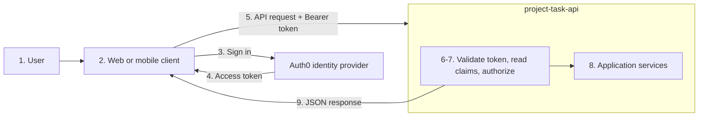

# Authentication and Authorization

Module 08 protects the Project and Task resources with two simple Bearer tokens. This is a focused course demonstration, not a production identity system.

## Two related decisions

| Question | Security concept | This application answers it by |
|---|---|---|
| Who sent this request? | Authentication | Matching the submitted Bearer token to a predefined user. |
| May that user perform this action? | Authorization | Checking the user's role before the route continues. |

Authentication happens first. A request with no valid identity receives `401 Unauthorized`. Authorization happens after a valid identity exists. A valid member who attempts a write receives `403 Forbidden`.

## Course-demo policy

| Role | Token configured in `.env` | Allowed endpoints |
|---|---|---|
| Member | `DEMO_MEMBER_TOKEN` | All protected `GET` endpoints |
| Administrator | `DEMO_ADMIN_TOKEN` | All protected `GET`, `POST`, `PUT`, and `DELETE` endpoints |

`/`, `/health`, `/docs`, `/redoc`, and `/openapi.json` remain public. Both token values in `.env.example` are demonstration values, not real secrets.

## Send a Bearer token

A client sends the token in the HTTP `Authorization` header:

```text
Authorization: Bearer member-demo-token
```

For example, a member can list Projects:

```bash
curl http://localhost:8000/projects \
  -H "Authorization: Bearer member-demo-token"
```

An administrator can create a Project:

```bash
curl -X POST http://localhost:8000/projects \
  -H "Authorization: Bearer admin-demo-token" \
  -H "Content-Type: application/json" \
  -d '{"name":"Demo Project","description":"Created by an administrator."}'
```

Swagger UI also reads the Bearer security scheme from OpenAPI. In `http://localhost:8000/docs`, select **Authorize** and enter one of the tokens.

## Request flow and dependency injection

The application handles a protected read request such as:

```text
GET /projects
Authorization: Bearer member-demo-token
```

with this route declaration:

```python
@router.get(
    "",
    response_model=list[ProjectResponse],
    summary="List all projects",
    description="Return every project currently stored by the application.",
    responses=AUTHENTICATED_RESPONSES,
)
def list_projects(
    _current_user: CurrentUser,
    service: ProjectService = Depends(get_project_service),
) -> list[Project]:
    """Return Projects after FastAPI authenticates the requesting user."""
    return service.list_projects()
```

`_current_user` is not a URL or JSON-body value sent by the client. FastAPI
resolves it before calling `list_projects()`. The leading underscore documents
that the route needs the authentication check but does not use the returned
user value. The service is also injected by FastAPI from the application state
selected during startup.

### Parameter aliases

```python
CurrentUser = Annotated[AuthenticatedUser, Depends(get_current_user)]
```

The alias contains the expected value type and a FastAPI `Depends(...)`
instruction describing how to obtain it. `Annotated` is standard Python
typing syntax; FastAPI reads the `Depends(...)` metadata and performs
dependency injection.

### Extracting Bearer credentials

`get_current_user()` has another dependency:

```python
def get_current_user(credentials: BearerCredentials) -> AuthenticatedUser:
    if credentials is None or credentials.scheme.lower() != "bearer":
        raise unauthenticated()

    user = get_user_for_token(credentials.credentials)
    if user is None:
        raise unauthenticated()
    return user
```

`BearerCredentials` tells FastAPI to run `HTTPBearer` first:

```python
bearer_scheme = HTTPBearer(
    auto_error=False,
    scheme_name="BearerAuthentication",
)

BearerCredentials = Annotated[
    HTTPAuthorizationCredentials | None,
    Depends(bearer_scheme),
]
```

`HTTPBearer` reads the HTTP `Authorization` header. Given:

```text
Authorization: Bearer member-demo-token
```

it returns an object equivalent to:

```python
HTTPAuthorizationCredentials(
    scheme="Bearer",
    credentials="member-demo-token",
)
```

FastAPI supplies that object as the `credentials` argument of `get_current_user()`. `auto_error=False` means a missing or malformed credential becomes `None`, allowing the application to return its consistent `401 Unauthorized` response with `WWW-Authenticate: Bearer`. `scheme_name` supplies the security-scheme name in OpenAPI and Swagger UI; it does not change the HTTP header format.

### One complete `GET /projects` request

```text
1. Client sends GET /projects with Authorization: Bearer member-demo-token.

2. FastAPI selects list_projects().

3. FastAPI resolves current_user: CurrentUser.
   CurrentUser requires get_current_user().

4. get_current_user() requires credentials: BearerCredentials.
   BearerCredentials requires bearer_scheme.

5. HTTPBearer reads the Authorization header and returns credentials.

6. get_current_user() maps the token to:
   AuthenticatedUser(username="member", role=Role.MEMBER).

7. FastAPI supplies this object as `_current_user`.

8. FastAPI resolves `get_project_service()`, which returns the
   startup-selected service from `app.state`.

9. FastAPI calls `list_projects(_current_user=<AuthenticatedUser>,
   service=<ProjectService>)`. The route delegates to the service, and the
   service and repository query PostgreSQL when the database backend is active.

10. FastAPI validates and serializes the result as list[ProjectResponse],
    then sends 200 OK with JSON.
```

The route function does not manually call `bearer_scheme`, `get_current_user`, or `get_db`. FastAPI calls them because it recognizes their nested `Depends(...)` declarations.

`app/config.py` loads and validates the token values as part of the typed
`Settings` object during application startup. `app/auth/users.py` consumes
those validated settings and does not read environment variables directly.

## HTTP outcomes

| Situation | Status | Response behavior |
|---|---:|---|
| No token or unknown token | `401 Unauthorized` | Returns a JSON `detail` and `WWW-Authenticate: Bearer`. |
| Valid member uses a write endpoint | `403 Forbidden` | Returns a JSON `detail`; the request does not reach the service layer. |
| Valid token and allowed action | Normal endpoint status | For example, `200`, `201`, or `204`. |

The `HTTPBearer` dependency also adds the Bearer security scheme to `/openapi.json`. Route decorators document the relevant `401` and `403` responses.

### Write routes add authorization

Write routes use a nested dependency:

```python
AdminUser = Annotated[AuthenticatedUser, Depends(require_admin)]

def require_admin(current_user: CurrentUser) -> AuthenticatedUser:
    if current_user.role is not Role.ADMIN:
        raise HTTPException(
            status_code=status.HTTP_403_FORBIDDEN,
            detail="Administrator role required",
        )
    return current_user
```

FastAPI first resolves `CurrentUser`, then passes that resulting `AuthenticatedUser` as the `current_user` argument to `require_admin()`. This creates the write-route chain:

```text
Authorization header
  -> HTTPBearer extracts credentials
  -> get_current_user authenticates the token
  -> require_admin authorizes the user's role
  -> write route runs only for an administrator
```

## Tests

The test suite covers the same separation of responsibilities:

| Test location | What it verifies |
|---|---|
| `tests/unit/auth/test_dependencies.py` | Token mapping, `401` handling, and the administrator role check without FastAPI or PostgreSQL. |
| `tests/integration/test_authentication_authorization_api.py` | Public endpoints, missing/invalid tokens, member reads, member write rejection, and an administrator CRUD workflow. |
| `tests/conformance/test_authentication_authorization_contract.py` | OpenAPI publishes the Bearer scheme, security requirements, and documented security outcomes. |

Authentication API tests use an unauthenticated `database_client` for public
and `401` cases. Tests pass the `member_headers` or `admin_headers` fixture
explicitly when they need to verify member reads, rejected member writes, or
successful administrator writes.

## OAuth 2.0, OpenID Connect, and JWT

OAuth 2.0 is an authorization framework that defines how a client obtains an
access token from an identity provider. OpenID Connect adds standardized human
authentication and identity information on top of OAuth 2.0. JWT is a signed
token format often used for ID tokens and access tokens; it is not encrypted by
default, and possessing a JWT is not itself an authorization policy.

Two common high-level flows are:

- **Human user to service:** A web or mobile client uses an OAuth 2.0
  authorization flow with OpenID Connect. The user signs in with the identity
  provider, and the client receives an access token to call the API.
- **Service to service:** One service uses the OAuth 2.0 Client Credentials
  flow to authenticate as itself—without a human sign-in—and receive an access
  token. It then calls another service with that token and the required scopes,
  such as `inventory:read` or `orders:write`.

The access token may be a JWT or an opaque token. With a JWT, the API can
validate the token locally; with an opaque token, it may need to call the
identity provider's introspection endpoint.

This module uses fixed demo tokens so students can focus on Bearer headers,
`401` versus `403`, and role checks. A production API would use an identity
provider to issue short-lived access tokens and would manage credentials
securely.

### Typical integration with an identity provider

The following diagram shows a common arrangement when a third-party identity
provider such as [Auth0](https://auth0.com/) is used. It is a reference
architecture, not the implementation used in this course module.



The numbered flow is:

1. The user signs in through the web or mobile client.
2. The client sends the sign-in request to Auth0.
3. Auth0 authenticates the user.
4. Auth0 returns an access token to the client.
5. The client sends an API request with the token in the `Authorization:
   Bearer ...` header.
6. The API validates the token's signature, issuer, and audience using Auth0's
   published public signing keys (JWKS), which the API can cache.
7. The API reads identity and role or permission claims, then applies its
   authorization rules.
8. If the request is allowed, the API passes it to application services.
9. The API returns the response to the client.

Auth0 issues the access token, while `project-task-api` validates the token and
remains responsible for deciding whether the authenticated user may perform an
action. With JWTs, the API normally performs this validation locally after
retrieving Auth0's public keys. It does not need to call Auth0 for every
request. The role or permission information may be included in token claims;
the API can also map the identity to application-specific permissions when
needed. Opaque tokens are different: an API may need an introspection call to
the identity provider to learn whether the token is valid and what it permits.

### High-level token and permission flow

1. Auth0 determines the user's roles and permissions.
2. Auth0 places the relevant permissions—often in a `permissions` or `scope`
   claim—inside the JWT.
3. The API validates the JWT's signature, issuer, audience, and expiration.
4. The API reads the claims and checks whether the required permission is
   present.

The API does not blindly trust the claims; it trusts them only after validating
the token. Auth0 can be configured to include RBAC permissions in access tokens;
see [Auth0 RBAC permissions](https://auth0.com/docs/get-started/apis/add-api-permissions).

Roles themselves are not always included in the token. APIs commonly authorize
using permissions or scopes instead. If permissions change, an already-issued
JWT may continue carrying the old permissions until it expires, which is one
reason access tokens should have limited lifetimes.

Never log raw `Authorization` headers or token values. Even though this module's values are safe demonstration credentials, real Bearer tokens must be treated like passwords.
